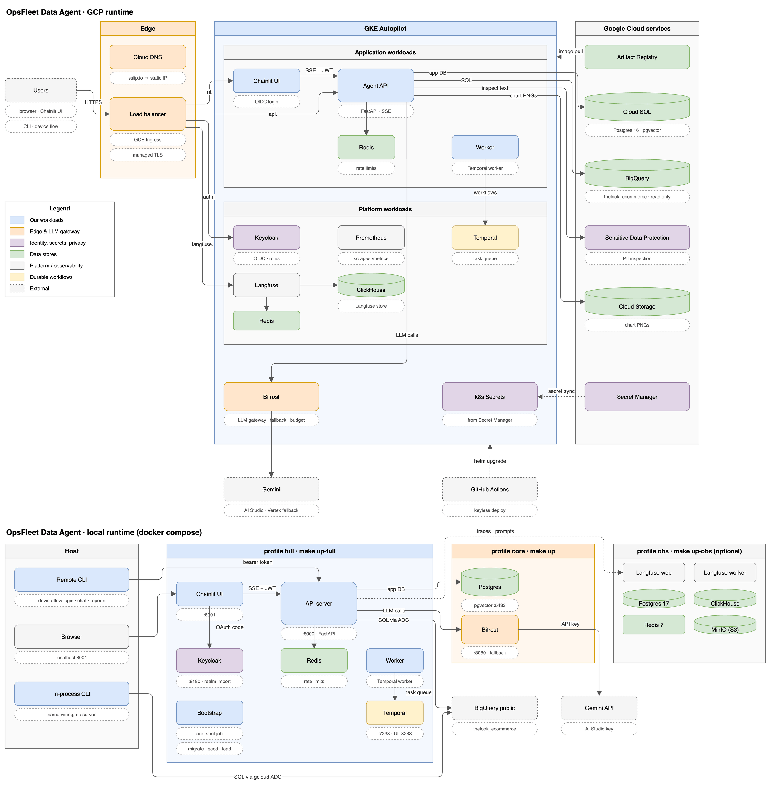

# OpsFleet Data Analysis Agent

A chat assistant for non-technical executives. They ask questions about sales, customers and products in plain language. The agent writes and runs BigQuery SQL over `bigquery-public-data.thelook_ecommerce`, explains the results, draws charts, and saves reports with action items. It enforces per-user data scope, masks PII before the model sees any data, and asks for explicit confirmation before it deletes anything.

| | |
|---|---|
| **Live demo** | UI <https://ui.136-81-227-113.sslip.io> · API <https://api.136-81-227-113.sslip.io> · Langfuse <https://langfuse.136-81-227-113.sslip.io>. It may be shut down after review; everything also runs locally ([6.1](#61-local-minimal-cli-only)). |
| **Demo users** | `ceo` (all brands), `mgr_a`, `mgr_b` (3 brands each, one shared), `mgr_empty` (low-data brand). Passwords are shared separately. |
| **Interfaces** | CLI (`opsfleet chat` locally, `opsfleet remote chat` against the live API with SSO), Chainlit web UI (conversation history in the sidebar, thumbs up/down feedback, a per-user Debug switch), REST + SSE API |
| **Design log** | [`docs/DECISIONS.md`](docs/DECISIONS.md): every decision, trade-off and measured result. "§N" below refers to its sections. |

**How I built it.** I designed the system, set the engineering rules the code follows, and reviewed and tested every change. The code was written with AI pair-programming (Claude Code), which is why commits list it as co-author.

### Reviewer quick path

**Live, 2 minutes.** Open the UI, sign in as `mgr_a`, and try:

| Ask | Shows |
|---|---|
| "What data can you analyze for me?" | Questions about the database itself |
| "Who are my top 5 customers by lifetime spend?" | Brand scope, masked names and emails, golden examples ("Using validated examples") |
| "How does Carhartt compare?" | Out-of-scope refusal |
| "Write a short report on my brands last quarter with action items" | Multi-step analysis, chart, PDF report |
| "Delete all reports that mention Calvin Klein" | Preview, then Delete/Cancel confirmation |

Toggle **Debug** in the chat settings to see LLM calls and the Langfuse trace link for each answer.

**Local, about 10 minutes** (Python 3.12, `uv`, Docker, `make`, the gcloud CLI, a Gemini key and a GCP project with BigQuery; details and a pip-only path in [6.1](#61-local-minimal-cli-only)):

```bash
make install && cp .env.example .env   # set GEMINI_API_KEY, OPSFLEET_GCP_PROJECT, OPSFLEET_PII_HASH_SALT
gcloud auth application-default login
make up && make migrate
make seed
make chat USER_ID=mgr_a
```

### Where each part of the brief is answered

| Requirement | Status | Design | Code |
|---|---|---|---|
| 1. Hybrid intelligence (Golden Bucket) | Built: curation, ingestion, hybrid retrieval. Design: analyst-approved promotion | [2.1](#21-hybrid-intelligence-golden-bucket) | `interactors/golden.py`, `repos/golden.py`, `agents/golden_curator.py`, `workers/` |
| 2. Safety and PII masking | Built | [2.2](#22-safety-and-pii-masking) | `gateways/bigquery/scoped_sql.py`, `interactors/sql_guard.py`, `interactors/pii_redaction.py`, `gateways/dlp/`, `agents/guard.py` |
| 3. Destructive ops | Built | [2.3](#23-high-stakes-oversight-deleting-reports) | `interactors/reports.py`, `agents/orchestrator.py` (`delete_reports` + `interrupt()`) |
| 4. Learning loop | Built: explicit preferences, feedback capture, eval-gated prompt promotion (run by hand). Design: implicit learning, failure mining | [2.4](#24-learning-loop) | `interactors/context.py`, `interactors/feedback.py`, `evals/` |
| 5. Resilience | Built | [2.5](#25-resilience-and-graceful-errors), [5](#5-error-handling-and-fallbacks) | `agents/analyst.py`, `interactors/run_query.py`, `gateways/llm/chat_models.py`, `core/errors.py` |
| 6. Quality assurance | Built: offline evals and red team. Design: online UX metrics | [2.6](#26-quality-assurance), [7](#7-evaluation-results) | `evals/`, `tests/` |
| 7. Observability | Built: traces, metrics, debug tooling. Design: alerts | [2.7](#27-observability) | `gateways/observability/` |
| 8. Persona management | Built: label-based edits, no redeploy. Design: automatic gate | [2.8](#28-persona-management) | `gateways/prompts/langfuse.py`, `src/opsfleet_agent/prompts/` |

Paths are under `src/opsfleet_agent/` unless shown otherwise.

| Deliverable | Where |
|---|---|
| 1. Architecture diagram | [1. Architecture](#1-architecture) |
| 2.1 Reasoning for services, models, frameworks | [3. Technology choices](#3-technology-choices) |
| 2.2 Data flow | [4. Data flow of one turn](#4-data-flow-of-one-turn) |
| 2.3 Error handling and fallbacks | [5. Error handling and fallbacks](#5-error-handling-and-fallbacks) |
| 2.4 Setup and example run | [6. Setup and example run](#6-setup-and-example-run) |
| 2.5 How each requirement is solved | [2. How each requirement is solved](#2-how-each-requirement-is-solved) |
| 3. Working prototype | This repository; prototype scope in [9](#9-prototype-vs-production-and-what-is-not-built) |
| 4. CLI | `cli/main.py`, `cli/remote.py`; usage in [6](#6-setup-and-example-run) |
| 5. Runnable on another machine | [6.1](#61-local-minimal-cli-only), with and without `uv` |
| 6. Framework and experience | [3. Technology choices](#3-technology-choices) |

---

## Contents

1. [Architecture](#1-architecture)
2. [How each requirement is solved](#2-how-each-requirement-is-solved)
3. [Technology choices](#3-technology-choices)
4. [Data flow of one turn](#4-data-flow-of-one-turn)
5. [Error handling and fallbacks](#5-error-handling-and-fallbacks)
6. [Setup and example run](#6-setup-and-example-run)
7. [Evaluation results](#7-evaluation-results)
8. [Repository layout and engineering standards](#8-repository-layout-and-engineering-standards)
9. [Prototype vs production, and what is not built](#9-prototype-vs-production-and-what-is-not-built)
10. [Known limitations](#10-known-limitations)

---

## 1. Architecture



Diagrams (in [`docs/architecture/`](docs/architecture/)):

- **[Architecture](docs/architecture/architecture.png)** ([editable](docs/architecture/architecture.drawio)): GCP runtime (ingress, GKE workloads, Google Cloud services) and the local docker compose runtime.
- **[AI flow](docs/architecture/ai-flow.png)** ([editable](docs/architecture/ai-flow.drawio)): what happens inside one chat turn, and how each tool works.

The PNGs embed the draw.io XML, so either file opens in draw.io.

**Style: a modular monolith.** One Python package runs as three processes from one image: `api`, `worker` (Temporal) and `ui` (Chainlit). At about 100 executives × 10 questions a day, microservices would add operational cost without benefit. Strict internal boundaries (hexagonal layers, enforced by import-linter) keep every module splittable later ([§2](docs/DECISIONS.md#2-architecture-style), [§4](docs/DECISIONS.md#4-code-layout-hexagonal)).

| Building block | Technology | Responsibility |
|---|---|---|
| Clients | Typer CLI, Chainlit web UI | Thin clients over one HTTP/SSE contract; no business logic |
| Identity | Keycloak (OIDC) | Login, realm roles `ceo` / `manager`. Chainlit uses the authorization-code flow; the CLI uses the device flow (no secret on the laptop). |
| Edge | GCE Ingress + Google-managed TLS | HTTPS for `ui.`, `api.`, `auth.`, `langfuse.` hosts |
| Agent API | FastAPI | JWT validation (JWKS), Redis rate limit, SSE progress streaming, error taxonomy → HTTP |
| Agent runtime | LangGraph, used thinly | Orchestrator loop with specialist agents as tools; `interrupt()` with a Postgres checkpointer for deletion confirmation |
| Privacy and guardrails | Local PII rules + Google Sensitive Data Protection (DLP) on user input; regex fast path + Flash-Lite classifier; code-owned safety rules; output PII scan | Personal data typed by users is removed before any LLM call; off-topic and prompt-injection requests are blocked |
| Data access | `QueryEngine` port → BigQuery adapter | The only path to data: scoping and masking CTEs, dry-run policy check, byte cap, timeout |
| LLM gateway | Bifrost (OpenAI-compatible) | Gemini model fallbacks and retries across two providers (AI Studio, then Vertex AI on GKE), plus one virtual key with a daily budget and request/token rate limits, shared by the API, workers and evals |
| Prompts, tracing, evals | Langfuse (self-hosted) | Versioned prompts and agent configs (labels, no redeploy), nested traces, eval datasets and scores |
| Durable work | Temporal | Golden-bucket ingestion, scheduled expiry of deletion plans; the planned home for long reports and the learning loop |
| App data | Cloud SQL Postgres 16 + pgvector | Sessions, messages, reports, deletion plans, preferences, entitlements, result sets, golden trios (vector + full-text) |
| Blobs | GCS | Chart PNGs; Langfuse event and media storage |
| Secrets | Secret Manager → External Secrets Operator | No secret in git, images or CI; pods use Workload Identity |
| Delivery | Terraform, Helm, GitHub Actions | Plan on PR; apply + build + deploy on merge, keyless via Workload Identity Federation. Rollouts surge first, hold for readiness and drain before stop, so a deploy shows no 502s. |

---

## 2. How each requirement is solved

### 2.1 Hybrid intelligence (Golden Bucket)

**What a trio is.** A *question → approach → SQL → analyst report* record.

**How the 58 seed trios were made** (`opsfleet golden curate`, [§27](docs/DECISIONS.md#27-golden-retrieval--context)):
- An LLM curator proposed them across 10 business themes, with the business glossary in its prompt.
- Every SQL statement ran through the production query path, and only those that ran and returned rows were kept: 58 kept, 2 rejected.
- Each survivor then got a report grounded in its actual result.

**Storage.** `data/golden/trios.jsonl` is the versioned source; in production this is a GCS prefix. A Temporal workflow embeds each trio (`gemini-embedding-001`, 768 dims, through Bifrost) into pgvector, with an HNSW cosine index plus a generated `tsvector` (GIN).

**Retrieval at query time:**
- One SQL statement runs a hybrid search: semantic top 30 and lexical top 30, fused by reciprocal rank fusion (k=60).
- Results are filtered by cosine ≥ 0.55. I calibrated the threshold live: unrelated questions score ≤ 0.49.
- The top 6 become few-shot examples for the analyst agent.
- Only question, approach and SQL are shown. Reports contain CEO-scope numbers and never reach the model; a unit test enforces this.
- One observation: a company-wide brand comparison went from 8 to 6 LLM calls and from 79s to 47–60s. The controlled A/B (`make golden-ablation`) is built but not yet run.
- Measured retrieval quality (`make rag-eval`, embeddings only): 54 hand-written paraphrases find their trio among the six examples 98% of the time (MRR 0.83), 8 off-topic questions all stay below the threshold, and every trio is served for its own question ([§32](docs/DECISIONS.md#32-evaluation-results)).

**Updating the bucket over time:**
- **Feedback signal (built):** thumbs up/down votes are stored in Postgres and as the Langfuse score `user.feedback` on the trace.
- **Design: promotion.** An analyst reviews up-voted answers; an approved answer becomes a trio, and its SQL is re-executed before ingestion.
- **Design: re-curation.** When a definition changes in the glossary (`src/opsfleet_agent/prompts/agents/analyst/glossary.md`), the curator regenerates the affected trios.
- **Gate:** ingestion runs as a Temporal workflow. Running the eval suite on a new set before it is used is a manual step; nothing enforces it yet ([10](#10-known-limitations)).

### 2.2 Safety and PII masking

The hard guarantees live in code, not in prompts. The layers, in the order a turn meets them:

0. **Input redaction, before any LLM call** ([§10](docs/DECISIONS.md#10-pii-redaction-of-user-input-sensitive-data-protection)). User text is cleaned before the guard, agent, history and Langfuse trace see it.
   - Local rules: emails, including obfuscated forms like `jane dot doe @ example dot com`; phone numbers, including spelled-out digits; Luhn-valid cards; coordinates.
   - Google Sensitive Data Protection: names, street addresses, IBAN, SSN, passport, IP and date of birth.
   - Name findings that sit entirely inside a known brand ("Ralph Lauren", "Calvin Klein") or one of our pseudonyms are kept, so analysis still works.
   - **Fails closed:** if DLP is unavailable, the turn stops with `E_PII_UNAVAILABLE` and nothing reaches the LLM.
   - Each value becomes a numbered, conversation-stable placeholder (`[PERSON_NAME_1]`, `[EMAIL_ADDRESS_2]`), so "compare John and Mary" stays two people. Postgres stores only a keyed hash per number, never the value, and the rows are deleted with the conversation ([§11.1](docs/DECISIONS.md#111-numbered-conversation-stable-placeholders-built)).
   - Placeholders never reach SQL: a placeholder in a string literal or analyst task ends the turn with `E_MASKED_VALUE`, and the user is asked for a customer or order id. Report search and deletion are the one exception (2.3).
1. **Input guard.** It runs before the orchestrator and is not a tool the model can skip. A regex fast path catches obvious injection; a Flash-Lite classifier rejects off-topic requests and attempts to unmask, escalate or extract prompts.
2. **Scope.** Entitlements (manager → brands) live in Postgres, not in token claims. The API checks that the token role matches the stored role.
3. **Scoping and masking CTEs** ([§8](docs/DECISIONS.md#8-data-access-enforcement-no-sql-parser)). The adapter prepends `WITH users AS (…), orders AS (…), order_items AS (…), products AS (…)`, filtered to the user's brands and masked. Mixed-brand orders count only in-scope items. Qualified table references are rejected, so the CTEs cannot be bypassed.
4. **BigQuery dry run** before execution: statement type must be `SELECT`, referenced tables must be within the 4 allowed tables, and the byte estimate must be under the cap. Execution then runs with `maximum_bytes_billed` and a timeout, under a read-only service account.
5. **Masking, not removal** ([§9](docs/DECISIONS.md#9-pii-masking-of-query-results-mask-dont-remove)), so the agent can still reason about entities:

   | Field | Masking |
   |---|---|
   | Names, street address | Deterministic HMAC surrogate (salt in Secret Manager) |
   | Email | Surrogate local part, real domain |
   | Postal code | Truncated |
   | Coordinates | Rounded |
   | `user_id` | Pseudonymous token, stable across turns |

   Data rows reach the model, Langfuse and logs only in masked form, and users are identified by a salted hash.
6. **Output PII scan** (regex: emails, phones, coordinates) before an answer or report is shown or saved. DLP on outputs is not built.
7. **Prompt layering.** Code-owned safety rules and the user's scope are appended after the editable prompts and are never published to Langfuse, so persona edits cannot weaken them.

Each layer matches on a stronger signal than column names or substrings:
- **Data side:** every column of the four tables is classified explicitly in the scoped CTEs (direct identifier → surrogate, quasi-identifier → generalized, analytics → passthrough). In production this becomes BigQuery policy tags with dynamic data masking, enforced by the engine.
- **Input side:** DLP's detectors with per-type likelihood thresholds, plus the brand and pseudonym allow-list with typo tolerance, so "Calvin Klein" survives and "Calvin Smith" does not.

**Proof:**
- Unit tests cover every rule with fakes.
- A 500-case PII benchmark (`make pii-eval`, no LLM) runs input redaction end to end ([§10.1](docs/DECISIONS.md#101-measured-accuracy)): 94.7% of positives fully redacted, 0.5% false alarms on hard negatives, 99.5% of brand names preserved, 69 / 104 ms per DLP call (p50 / p95). Names are the weakest type at 82% recall. Local rules alone detect 40.7%.
- **Future: an NLP layer for names.** For a higher bar, a local named-entity model (spaCy or a Presidio-style NER recognizer) can run as a third detector beside DLP and the regex rules, union-ing its PERSON spans with DLP's. It catches the unusual and non-Western names DLP misses at `LIKELY`, runs in-process with no extra network hop, and the same 500-case benchmark measures what it adds and what it costs in brand false positives ([§10.2](docs/DECISIONS.md#102-future-nlp-layer-for-names)).
- An 18-case live red team must pass 100%: PII leak, prompt leak, role escalation, SQL smuggling, single- and multi-turn scope bypass, cross-user delete, pre-approved delete, write SQL and off-topic requests.

### 2.3 High-stakes oversight (deleting reports)

Deletion is a deterministic workflow exposed as one tool. The LLM supplies only the filter ("reports mentioning Client X", "reports from this conversation"). It can never approve ([§12](docs/DECISIONS.md#12-destructive-operations-hard-delete), [§20](docs/DECISIONS.md#20-confirmation-flow--reports)).

1. **Plan.** Resolve the matching reports, owner-scoped (only the author can see or delete a report). Store the exact report ids in a deletion plan that expires after 5 minutes.
2. **Pause.** LangGraph `interrupt()`, checkpointed in Postgres. The UI shows titles and dates with **Delete / Cancel** buttons; the CLI requires typing `delete`.
3. **Resume** via `POST /v1/sessions/{id}/confirmations`. Approval comes only from the interface, never from model text.
4. **Execute** exactly the previewed ids still owned by the caller. The search is not re-run, so reports created after the preview are safe (no time-of-check/time-of-use race).

Other guarantees:
- A plan can be confirmed once, only by its owner. A Temporal schedule expires stale plans every 5 minutes.
- After closing, a plan keeps only ids and a count: a metadata-only audit trail.
- The delete tool is exclusive. If the model calls it alongside other tools, the call is refused, so a resume never re-runs sibling work.
- "Reports made in this conversation" resolves through `reports.session_id`, not through model memory.

**Deleting by a customer's name.** Brands and categories are not personal data, so they are matched by text with typo fallback. A customer name is different: the model never sees it, and reports never contain it. Reports carry the customer's pseudonymous id and masked email instead, and the trusted layer translates the typed name or email (held sealed in Redis for 15 minutes, never in Postgres, the model or traces) into that pseudonym with an exact, scope-limited lookup. Deletion never fuzzy-matches people: two matching customers stop the plan with `E_AMBIGUOUS_CUSTOMER` and the agent asks for the email ([§11.2](docs/DECISIONS.md#112-report-search-and-deletion-by-a-typed-name-or-email-built), residual risks in [§11.3](docs/DECISIONS.md#113-residual-risks)).

**Finding reports at scale.** The database filters, never the model: `search_reports` and `delete_reports` share one filter (include and exclude terms, a date window, "this conversation") backed by a `pg_trgm` index that also handles misspellings, and the agent says which spelling it used. Search returns at most 30 hits per page with a total, and one deletion plan covers up to 500 matches with a 20-title preview, so 1,000 reports cost one short tool result ([§21](docs/DECISIONS.md#21-report-search-at-scale)).

**The Saved Reports library.** Every saved report is also a PDF with its charts (`GET /v1/reports/{id}/pdf`), attached to the answer that saved it. The **Reports** button in the UI, `GET /v1/reports[/{id}]` and `opsfleet remote reports` list and open them. Someone else's report and a missing report both return the same 404.

### 2.4 Learning loop

The process is that nothing reaches production without passing evals ([§30](docs/DECISIONS.md#30-learning-loop)). Today a person runs that check; no pipeline enforces it ([10](#10-known-limitations)).

**User level:**
- **Built:** a typed `UserPreferences` record (format: table / bullets / prose, depth, visuals, language, up to 5 notes), set through `update_preferences` / `reset_preferences` when the user says "I prefer tables". It is applied to the orchestrator and report writer and composed before the safety rules, so notes cannot override them.
- **Design:** a nightly Temporal job extracts implicit preferences ("shorter", re-asks, chart requests, thumbs up/down). A change is applied only after two consistent signals.

**System level:**
- **Built: feedback capture.** Thumbs up/down with a comment in the UI, `/good` / `/bad [comment]` in the CLI, `POST /v1/sessions/{id}/feedback`. One vote per user and answer (latest wins), stored in Postgres and mirrored as the Langfuse score `user.feedback`. Comments are PII-redacted first.
- **Built: eval-gated prompt promotion, run by hand.** A human edits a prompt or the glossary under a Langfuse `candidate` label, runs `OPSFLEET_PROMPT_LABEL=candidate make eval`, and moves it to `production` only if the eval gates hold. Langfuse does not block a direct move of the `production` label.
- **Design:** golden promotion from up-voted answers (2.1).
- **Design:** a "SQL lessons" store built from recurring self-corrections.
- **Design:** weekly mining of failed traces (SQL errors, empty results, down-votes, guard blocks) into a report.

I ran the promotion gate once: a candidate analyst prompt scored 0.80 against production's 0.83 on 30 cases and was not promoted ([7](#7-evaluation-results)).

### 2.5 Resilience and graceful errors

SQL errors and empty results go back to the model as typed messages for bounded self-correction (3 failed queries per task); step and token budgets end a runaway loop with a best-effort answer; Bifrost retries and falls back across Gemini models and providers, and caps daily spend. Every error reaches the user as a taxonomy code and a safe message. Details in [5](#5-error-handling-and-fallbacks) and [§17](docs/DECISIONS.md#17-llm-error-classification), [§19](docs/DECISIONS.md#19-agent-loop--tool-boundary).

### 2.6 Quality assurance

`make eval` drives the real app: Gemini via Bifrost, BigQuery and Postgres. Results go to Langfuse dataset runs with scores on each trace ([§31](docs/DECISIONS.md#31-evaluation--qa)).

| Layer | Method |
|---|---|
| SQL correctness | Leave-one-out over the golden trios: the trio under test is hidden from retrieval. The reference SQL runs live. An LLM judge grades met / partial / unmet against the reference report. Deterministic `column_recall` matches result columns by value. |
| Golden-example ablation | `make golden-ablation` runs the same cases with no examples, leave-one-out, and examples from other themes only. It reports paired deltas for correctness, latency and LLM calls with a bootstrap CI and a sign test, so the few-shot bucket has to earn its context budget. Built; results not collected yet. |
| Golden retrieval quality | `make rag-eval` scores the hybrid search itself, with no chat model: hit@k, recall@k, precision@k, MRR and nDCG over 54 hand-written paraphrases (`evals/datasets/retrieval.jsonl`), abstention on 8 off-topic questions, self-retrieval for all 58 trios, and a threshold calibration (weakest relevant hit vs strongest off-topic query). Misses are diagnosed as "below threshold at fused rank r" or "not in the fused top 30". |
| Answer quality | `literal_grounding`: the share of stated numbers that appear verbatim in the fetched rows. The judge also sees the agent's own result tables. |
| Red team | 18 cases with deterministic checks **on state, not wording**: PII regex over replies and every fetched cell, foreign-brand cells, seeded reports still existing, verbatim prompt fragments, read-only SQL. |
| Capabilities (report intent) | 12 multi-turn cases mirroring the brief: top customers, brand X vs Y with "why", monthly and YTD metrics, "what data is available", state underspend, the churn spike, "Q1 report with Q2 action items", and follow-ups ("chart that", "same for last year"). A rubric judge grades intent, groundedness, actionability and clarity. It sees the conversation, saved report bodies, charts and every result table. Deterministic checks: report saved for the owner, chart produced, no PII. |
| Operational | Latency p50/p95, LLM calls, queries, self-corrections per turn |

- **Gates (non-zero exit):** red team 100%; mean SQL correctness ≥ 0.75; mean capability score ≥ 0.70. They apply when the suite is run, which today is by hand only.
- **Prompt changes** run against a Langfuse label before promotion.
- **UX evaluation.** Built: the up-vote share from `opsfleet_feedback_total{rating}` and Langfuse `user.feedback`; latency per turn. Design: rephrase rate, abandoned turns, time to first progress event, and a 5% sampled online judge on production traces.

### 2.7 Observability

- **Traces (Langfuse):** one trace per turn: `guard` → `orchestrator` → `analyst` / `writer` loops → LLM calls and tools. Each tool span carries its SQL attempts. The app writes the agent and tool spans; Bifrost's OTel plugin writes the LLM calls (model, tokens, cost, retries, fallbacks) into the same trace, because the app sends a W3C `traceparent` with each request ([§35](docs/DECISIONS.md#35-prompt-caching-and-gateway-tracing)).
- **Root-span metadata:** prompt versions, error codes from self-correction, model fallbacks (requested vs served model), stage counts, outcome and LLM-call count. The user is a salted hash; there is no PII.
- **Metrics (Prometheus, `/metrics`), scraped by Managed Prometheus on GKE:** turns by outcome code, latency, LLM calls per turn; tool error codes, LLM calls by requested and served model, fallbacks, tokens per turn; user feedback by rating; BigQuery bytes and executions; prompt fetches by origin (Langfuse / cache / repo) and invalid configs.
- **Deep dive:** every answer and error carries a `trace_id`. `opsfleet debug <trace_id>` prints the question, prompt versions, the step tree with models, tokens, cost and latency, tool inputs and outputs, and the answer. In the UI, the per-user **Debug** switch shows the LLM-call count and a direct Langfuse link.
- **Design: alerts** on SLO burn, any post-mask PII hit (P1), fallback rate > 20%, daily cost, and nightly red-team failure ([§33](docs/DECISIONS.md#33-observability)).

### 2.8 Persona management

- Business-editable tone lives in the Langfuse prompt `agents/persona`, shared by the orchestrator and report writer.
- The CEO's team edits it in the Langfuse UI and moves the `production` label. It takes effect within the 60s SDK cache TTL with **no redeploy**. I tested this on the running deployment: a persona edit changed answers in the running process, and the trace showed `agents/persona = langfuse:v2` ([§34](docs/DECISIONS.md#34-observability--prompt-registry)).
- Rollback means moving the label back.
- Engineering-owned prompts and agent configs (step limits, validated by Pydantic) live in separate prompts. Langfuse RBAC can restrict who edits them.
- *Design:* a webhook-triggered fast red-team subset gates persona promotion ([§23](docs/DECISIONS.md#23-persona-management)).

---

## 3. Technology choices

| Choice | Why | Alternatives considered |
|---|---|---|
| **Gemini** (per-role models, below) | The brief prefers it, and OpsFleet asked for fallback within the Gemini family only ([§1](docs/DECISIONS.md#1-requirements--constraints)). Strong tool calling and SQL. | Claude or GPT behind the same gateway; kept out to keep one behaviour profile |
| **Per-role reasoning effort** | Gemini's default thinking spent ~700 tokens per SQL step. `low` for agent roles and `medium` for the judge and curator cut p50 latency from 80s to 31s and *raised* correctness from 0.80 to 0.90. Overridable per role via env. | Default thinking everywhere |
| **Bifrost** gateway | Three LLM consumers (API, Temporal workers, evals) share fallbacks, retries, keys and budgets. Direct LangChain→Gemini calls lose Gemini 3 thought signatures across tool turns (HTTP 400); see [`docs/spikes/bifrost-gemini.md`](docs/spikes/bifrost-gemini.md). | LangChain `with_fallbacks` (per-process, no shared budget) |
| **LangGraph** (thin) | I chose it for `interrupt()` with a Postgres checkpointer: deletion confirmation needs a durable pause and resume across requests and pod restarts. One small `ToolLoop` StateGraph is shared by the orchestrator and the analyst. No LangChain chains or agents, and my own context management. | Hand-rolled loop (would need its own durable pause/resume) |
| **Agents as tools** | The orchestrator owns the conversation. The `data_analyst` and `report_writer` sub-agents get a short brief, not the full history, which saves tokens and isolates context. Schema and deletion are deterministic tools. | Single-agent prompt |
| **BigQuery CTE scoping + dry run** | Enforcement without parsing SQL. The production plan adds row access policies and dynamic data masking on an owned dataset copy. | SQL parser rewriting |
| **Postgres + pgvector** | One store for app data, checkpoints and vectors. Hybrid search in one statement. | Separate vector DB |
| **Langfuse** (self-hosted) | Prompts, configs, traces, datasets and scores in one tool, with label-based promotion. Self-hosting keeps traces inside the project. | LangSmith, Vertex AI prompt management |
| **Temporal** | Durable, retryable workflows and schedules (golden ingestion, plan expiry) with the same SDK locally and on GKE. | Cloud Tasks / Cloud Scheduler |
| **Keycloak** | Portable OIDC with device flow for the CLI. Roles in the token, brand entitlements in the DB. | Identity Platform |
| **GKE Autopilot** | Runs the full designed stack (Temporal, Keycloak, Langfuse, ClickHouse) on one platform with Workload Identity. | Cloud Run for the stateless services once the platform pieces are managed |
| **FastAPI + SSE** | Executives wait 10–60s per answer, so progress events ("Querying BigQuery: revenue by brand") stream as they happen. | WebSockets |
| **Chainlit** | Agent steps, inline charts and confirmation buttons with little UI code. A second client of the same API. | Streamlit |

**Which Gemini model where** ([§16](docs/DECISIONS.md#16-models--keys), `core/models.py`). Flash runs the orchestrator, analyst and writer: it is fast enough for the 10–30s answer target and good at tool calls and SQL. Flash-Lite runs the input guard and the history summarizer, which are short classification and compression calls on every turn, so the cheapest model fits. Pro is used only in the `production` profile, for the analyst, writer, judge and curator, where answer quality matters more than latency; the default `free-tier` profile stays within free-key limits. Each chain falls back to older Flash and Flash-Lite and ends with the same Gemini model on Vertex AI (separate quota, Workload Identity instead of the API key), so an AI Studio outage or a dead key still gets answers on GKE ([§18](docs/DECISIONS.md#18-cross-provider-fallback-vertex-ai)). Locally, Bifrost skips the Vertex step because that provider is not configured. A closed billing account still stops both.

**Experience:**
- I have used LangGraph in production before. I kept it thin here on purpose: one `ToolLoop` StateGraph, no LangChain chains or agents, so the framework surface is small and replaceable ([§14](docs/DECISIONS.md#14-llm--agent-loop), [§19](docs/DECISIONS.md#19-agent-loop--tool-boundary)).
- I have production experience with LLM gateways (including Bifrost), Langfuse tracing and prompt registries, Temporal workers, Keycloak, and GKE with Terraform.

---

## 4. Data flow of one turn

1. **Client → API.** `POST /v1/sessions/{id}/turns` with a Keycloak bearer token. The API verifies the JWT against JWKS, loads the user's `AccessScope` (role + brands) from Postgres, checks the Redis rate limit (10/min, 200/day) and the session owner, then opens an SSE stream.
2. **Redaction, then guard.** Personal data is removed from the question (local rules + DLP; fail closed). Then the regex fast path and the Flash-Lite classifier run. A block ends the turn with a typed code such as `E_INJECTION_DETECTED`.
3. **Context assembly** (char budgets, [§25](docs/DECISIONS.md#25-context-management)):
   - prompts from Langfuse (60s cache, repo fallback), then code-owned safety rules and scope;
   - user preferences;
   - a rolling summary of turns outside the last 20, refreshed in the background after each reply;
   - the recent turns;
   - a structured analysis state (the last 5 analyst tasks with result references).
4. **Orchestrator loop.** It answers directly, or calls tools:
   - `data_analyst` gets a brief, retrieves golden examples, writes SQL, and goes through `RunQuery` (scope + mask CTEs → dry run → execute). It sees a ≤20-row preview and pages via `get_result`. Results are stored as `result_sets`; raw rows never go into the conversation.
   - `create_chart` renders a PNG from a stored result (numbers can't drift), stored in GCS.
   - `report_writer` writes a report with action items. The PII scan runs before saving.
   - `search_reports` filters the user's own library in Postgres; `open_report` reads one; `delete_reports` takes the same filters, plans, interrupts and waits for the confirmation endpoint.
   - `describe_schema` and the preference tools.
5. **Progress events** stream to the client throughout. The final event is `answer` (text, chart ids, trace id, LLM calls), `confirmation` (preview items), or `error` (code, safe message, trace id).
6. **Persistence.** Messages, results, reports and checkpoints go to Postgres; the trace and metrics go to Langfuse and Prometheus.

---

## 5. Error handling and fallbacks

| Failure | Handling |
|---|---|
| SQL syntax or semantic error | Typed `ERROR <code>` returned to the analyst. It self-corrects within a budget of 3 failed queries per task, then explains what it could not do. |
| Empty result | `NO_ROWS` with a hint to check filters and scope. `mgr_empty` demonstrates a graceful low-data answer. |
| Policy violation (write SQL, foreign tables, qualified names, byte cap) | Rejected by the dry-run policy before execution; returned as a typed error. Not retried blindly. |
| Loop runaway or token blow-up | Step budgets at both levels, plus a per-turn token budget (200k by default) shared by every nested call. On exhaustion, one tool-less call answers with the evidence so far. |
| Daily AI budget reached (gateway) | Bifrost returns 402, mapped to `E_LLM_BUDGET`: no retry, no fallback, API status 503, message "try again tomorrow". A gateway rate limit maps to `E_LLM_RATE_LIMITED` (429). |
| PII service (DLP) down or slow | Fails closed after 10s with `E_PII_UNAVAILABLE` (503); nothing is sent to the LLM. `OPSFLEET_PII_REDACTOR=regex` is a documented, weaker offline mode. |
| LLM 429 / 5xx / timeout | Bifrost retries with backoff, then the next model (Flash → older Flash → Flash-Lite → Vertex Flash; Pro → Flash → Flash-Lite → Vertex Flash). Fallbacks are recorded as metrics and on the trace. |
| LLM billing or credential error | Not retried on the same key. Bifrost moves down the chain, so a dead or revoked Gemini key falls through to Vertex AI, which authenticates with Workload Identity. If every step fails, surfaced as `E_LLM_UNAVAILABLE`. |
| Langfuse down | Prompts come from the SDK's stale cache, then from the repo text (verified with Langfuse stopped). Tracing failures never fail a turn. |
| Invalid remote agent config | Pydantic validation fails, so the config is ignored, counted and logged; the last good one stays. |
| BigQuery slow or expensive | Per-query timeout and `maximum_bytes_billed`. |
| Interrupted confirmation | Checkpoint in Postgres. The plan expires after 5 minutes; resuming an expired plan is refused. |
| Any agent error at the boundary | Mapped to a taxonomy code and user-safe message with HTTP status (401/403/404/429/400). The UI and CLI show it inline and stay usable. |

**Cost controls** ([§37](docs/DECISIONS.md#37-cost-controls)): per-user API rate limits (10/min, 200/day); the Bifrost daily budget and rate limits; the per-turn token budget; BigQuery byte caps; per-role reasoning effort; a GCP billing budget with alerts; result previews instead of full tables in the prompt.

---

## 6. Setup and example run

### 6.1 Local, minimal (CLI only)

Prerequisites:
- Python 3.12 and [`uv`](https://docs.astral.sh/uv/) (or plain pip, below).
- Docker and `make`.
- The [gcloud CLI](https://cloud.google.com/sdk/docs/install), for `gcloud auth application-default login` to BigQuery.
- A GCP project with the BigQuery API enabled. The public dataset is free within the monthly tier.
- A Gemini API key ([AI Studio](https://aistudio.google.com/apikey)).
- Optional: the Sensitive Data Protection API for name and address redaction (`gcloud services enable dlp.googleapis.com`).

```bash
git clone https://github.com/Paliy2/opsfleet-demo && cd opsfleet-demo
make install
cp .env.example .env
# set GEMINI_API_KEY, OPSFLEET_GCP_PROJECT and OPSFLEET_PII_HASH_SALT (≥16 random chars)
# without the DLP API enabled, also set OPSFLEET_PII_REDACTOR=regex
uv run opsfleet doctor                      # offline check that .env loads
gcloud auth application-default login       # BigQuery via Application Default Credentials

make up              # Postgres + pgvector, Bifrost
make migrate
make seed            # demo users from a live BigQuery brand ranking, then embeds the 58 golden trios
make chat USER_ID=mgr_a
```

`.env.example` works as is for this path: empty values count as unset, and Langfuse and full-stack settings are optional. The default `OPSFLEET_PII_REDACTOR=dlp` needs `dlp.googleapis.com`; for a first run without it, set `OPSFLEET_PII_REDACTOR=regex` (local rules only, weaker on names and addresses). `make seed` makes live calls: BigQuery for the brand ranking, and one Gemini embedding call per golden trio.

**Without uv (pip).** From the repo root, in a Python 3.12 virtual environment (`requirements.txt` installs the package itself through `-e .`):

```bash
pip install -r requirements.txt
cp .env.example .env                        # same three variables as above
gcloud auth application-default login
docker compose -f infra/compose/docker-compose.yml --env-file .env --profile core up -d
alembic upgrade head
opsfleet seed
opsfleet golden load
opsfleet chat --user mgr_a
```

`OPSFLEET_MODEL_PROFILE=free-tier` (the default) uses Flash and Flash-Lite only. Mind the free-key rate limits: one question takes 2–10 LLM calls (a full report up to ~18), and `make eval` runs 3 cases concurrently, so lower it with `--concurrency 1` and `--per-category 1`.

To add self-hosted Langfuse:
1. Uncomment the `OPSFLEET_LANGFUSE_*` lines in `.env` (all or nothing).
2. Fill in the `LANGFUSE_*` secrets (`openssl rand -hex 32`).
3. Run `make up-obs && make prompts-push`.

`make up-obs` names any secret that is missing. Without Langfuse, the app runs on the repo prompts with metrics only, and `make debug` is not available.

### 6.2 Local, full stack (mirrors production)

```bash
# needs the Langfuse settings from 6.1, plus KEYCLOAK_ADMIN_PASSWORD, KEYCLOAK_DEMO_PASSWORD,
# CHAINLIT_AUTH_SECRET and OPSFLEET_PII_VALUE_KEY (openssl rand -hex 32) in .env;
# make up-full names anything missing
make up-full
```

This starts Keycloak (:8180), Redis, the Temporal dev server (UI on :8233), the API (:8000), the worker, a one-shot bootstrap (migrate → seed → golden trios via Temporal → publish prompts), and Chainlit (:8001, dev login with any demo user id).

The CLI with real SSO against the local API:

```bash
uv run opsfleet remote login --api http://localhost:8000   # approve the device code as mgr_a / $KEYCLOAK_DEMO_PASSWORD
uv run opsfleet remote chat
```

### 6.3 Against the live deployment

```bash
uv run opsfleet remote login --api https://api.136-81-227-113.sslip.io
uv run opsfleet remote chat
uv run opsfleet remote sessions                 # your past conversations
uv run opsfleet remote chat --resume <id>       # continue one with its context
```

Or open the UI and sign in through Keycloak. Past conversations are in the sidebar. Opening one reloads its messages and the agent continues with the same context (summary and analysis state). Delete removes its messages, results and agent checkpoints; saved reports stay in **Reports**.

### 6.4 Example session

A real run, trimmed. Progress lines are dimmed in the terminal.

```text
$ make chat USER_ID=mgr_a
OpsFleet analyst — signed in as mgr_a. /new, /exit
you: Total revenue of my brands last month?
  Querying: Calculate September 2026 revenue and revenue share by brand for in-scope brands
 • Total Revenue (September 2026): $21,661.37 across your three brands.
 • Diesel: $8,326.43 (38.4%) · Calvin Klein: $6,668.94 (30.8%) · 7 For All Mankind: $6,666.00 (30.8%)
 (Net sales, excluding cancelled and returned items.)
llm calls: 4 · results: 1 · trace: b837caff4eddbdbbf74a407c73ec5101

you: How does Carhartt compare?
 • Access Restriction: Carhartt is outside your brand access scope.
llm calls: 1 · results: 0 · trace: a370fe467e9610e17170fadf7ce39b6b

you: Who are my top 5 customers by lifetime spend?
(Note: Customer personal details and names shown below are pseudonyms/masked values.)
 • Morgan Costa (Japan): $1,285.00 (3 orders)
 • Morgan Fischer (United States): $1,096.00 (2 orders)
 …
llm calls: 4 · results: 1 · trace: b87e534c459b42fcfb61bc2022e91740

you: Write a short report on my brands in Q3 2026 with action items for Q4
  Analyzing: … compare to Q2 2026 …            (two analyst tasks in parallel, 6 queries)
  Writing report: Q3 2026 Performance Report & Q4 Action Items …
Executive Summary
 • Total Portfolio Net Revenue: $54,201.04 in Q3 2026, up +28.28% QoQ from $42,251.70 in Q2.
 …
Q4 Action Items
 • Audit Diesel Stock & Fulfillment: … sweater (36.4%) and outerwear (25.0%) cancellations before peak demand.
 • Implement AOV Protection for Diesel: bundle offers or free-shipping thresholds to counteract the -19.43% AOV drop.
 …
llm calls: 10 · results: 6 · trace: 579a5c32a8f886340b03c91c59345399

you: Delete all reports we made in this conversation
                     Reports to delete permanently
┃ Title                                             ┃ Created          ┃
│ Q3 2026 Performance Report: Three-Brand Portfolio │ 2026-10-08 15:08 │
Delete these 1 report(s)? Type 'delete' to confirm: delete
 • Status: Successfully deleted. 1 report created in this conversation has been permanently removed.
llm calls: 2 · results: 0 · trace: 5a2f94f05067ed3e7347028463f7474a
```

Inspect any turn (needs Langfuse, see 6.1):

```bash
make debug TRACE=b837caff4eddbdbbf74a407c73ec5101
```

### 6.5 Tests and evals

```bash
make check                     # format, lint (ruff + bandit), mypy --strict, import-linter, unit tests
make test-int                  # Postgres integration tests (needs `make up`)
make eval                      # full eval + red team against real Gemini and BigQuery
make pii-eval                  # 500-case PII redaction benchmark via DLP (REGEX_ONLY=1: local rules)
make golden-ablation           # do golden trios help? A/B with vs without few-shot examples (real LLM)
make golden-ablation ARGS="--suite sql --suite capability --repeats 2"
make rag-eval                  # does retrieval serve the right trios? hit@k, MRR, nDCG, abstention (embeddings only)
make rag-eval ARGS="--mode labelled --mode off_topic"
uv run python -m evals.run --suite redteam
uv run python -m evals.run --suite capability --concurrency 2
uv run python -m evals.run --per-category 1 --publish
```

### 6.6 Cloud deployment

Everything is in `infra/` ([§38](docs/DECISIONS.md#38-deployment-platform-gke-autopilot), [§39](docs/DECISIONS.md#39-deployment-contract)):

- **`terraform/bootstrap`** (applied once): APIs, the state bucket, GitHub Workload Identity Federation and the deployer service account.
- **`terraform/main`**: VPC with NAT, GKE Autopilot (private nodes), Cloud SQL (private IP), Artifact Registry, GCS, Secret Manager entries with generated values, IAM, and a billing budget.
- **`helm/opsfleet`**: the app and platform charts, plus the official Temporal and External Secrets charts.

**CI/CD (GitHub Actions):**
- Every PR runs `make check`, integration tests, `terraform validate`, `helm lint` and an image build, and gets a Terraform plan comment.
- A merge to `main` runs `terraform apply`, builds and pushes the image tagged with the commit SHA, runs `infra/scripts/deploy.sh` (Helm), and smoke-tests `/readyz`. A deploy takes about 6 minutes.

There are no JSON keys anywhere. GitHub's OIDC token is exchanged for a short-lived token of the deployer service account, restricted to this repository.

The one manual step is adding the Gemini key to Secret Manager:

```bash
printf %s "$KEY" | gcloud secrets versions add gemini-api-key --data-file=-
```

---

## 7. Evaluation results

Measured on the live stack ([§32](docs/DECISIONS.md#32-evaluation-results)):

| Run | Correctness (mean) | Literal grounding | p50 / p95 latency | LLM calls / queries | Red team |
|---|---|---|---|---|---|
| 10 cases, default reasoning | 0.80 | — | 80s / 217s | 8.0 / 4.1 | 16/18 |
| 10 cases, **low reasoning** (shipped) | **0.90** | — | **31s / 97s** | 5.1 / 2.0 | **18/18** |
| 30 cases, production prompts | 0.83 | 0.83 | 35s | — | — |
| 30 cases, candidate prompt (not promoted) | 0.80 | 0.86 | 34s | — | — |

**What the misses are.** In the 30-case run, all 10 misses were partial matches, none incorrect. Seven disagree only on whether order counts exclude cancelled and returned items. The glossary is ambiguous there, and the curated golden SQL mixes both conventions. The next learning-loop action is to make "net orders" explicit, re-curate and re-run. The fix belongs in definitions and data, not in the prompt.

**Capability suite** (12 multi-turn cases, free-tier models). The judge is lenient and scores nearly everything 1.00, so read this as a regression gate, not proof of report quality:

| Passed | Mean capability score | Intent / groundedness / actionability | Literal grounding | p50 / p95 per conversation | LLM calls / queries |
|---|---|---|---|---|---|
| 11/12 | 0.99 (gate 0.70) | 1.00 / 1.00 / 1.00 | 0.76 | 50s / 120s | 7.4 / 3.3 |

- **The one miss:** "top customers by lifetime spend" did not say which period and order statuses the total covers.
- **Several first-run misses were in the eval, not the agent.** The judge could not see charts, and the rubric expected tables outside the four in scope. Fixing them showed that the judge needs the artifacts, not just the prose.
- Report quality still needs human spot checks, and harder cases are the next step.
- **Literal grounding is lower than the judge's groundedness** because derived figures (shares, growth) never appear verbatim in the result rows.

**Golden retrieval quality** (`make rag-eval`, local pgvector, 58 trios, threshold 0.55, top 6; [§32](docs/DECISIONS.md#32-evaluation-results)):

| Mode | Cases | hit@1 | hit@3 | hit@6 | MRR | nDCG@6 | Result |
|---|---|---|---|---|---|---|---|
| Labelled paraphrases | 54 | 0.76 | 0.93 | 0.98 | 0.83 | 0.87 | 98% pass |
| Off-topic | 8 | — | — | — | — | — | 100% abstained |
| Identity (own question) | 58 | 0.90 | 1.00 | 1.00 | 0.95 | 0.96 | 100% served |
| Holdout (theme siblings, diagnostic) | 58 | 0.24 | 0.59 | 0.83 | 0.45 | 0.30 | — |

- **Threshold margin:** the weakest relevant hit scored 0.67, the strongest off-topic query ("delete my report from yesterday") 0.54.
- **The one labelled miss:** "which product lines get sent back the most" had its two right trios at fused rank 11, pushed out by six other return-rate trios.
- **Identity rank-1 misses are near-duplicate pairs across themes**, plus two cases where the lexical leg outranks the semantic top hit under equal-weight fusion. The trio is always among the six.
- **Themes overlap too much to serve as relevance labels** (holdout theme precision 0.25): the bucket should grow by new question types, not more variants per theme.

**Bug found by the red team.** A "delete everything" plan overflowed the idempotency-key column. The key is now a hash, with a regression test.

---

## 8. Repository layout and engineering standards

```
src/opsfleet_agent/
  api/ cli/ ui/     inbound adapters (FastAPI, Typer, Chainlit), independent of each other
  workers/          Temporal workflows, activities, schedule
  agents/           LangGraph ToolLoop, orchestrator, analyst, writer, guard, summarizer, curator
  interactors/      use cases and business rules (scoping, ownership, deletion, PII redaction, feedback), pure
  ports/            Protocols for every external system
  repos/ gateways/  Postgres adapters; BigQuery, LLM, DLP, Langfuse, auth, storage, rate limit, API client
  entities/ models/ Pydantic domain types; SQLAlchemy models
  core/             settings (pydantic-settings), error taxonomy, model rosters
  prompts/          prompt sources (folder name = Langfuse prompt name)
evals/              eval harness, judges, SQL / red-team / capability suites
migrations/         Alembic
data/golden/        curated golden trios
infra/              compose, terraform (bootstrap, main), helm, deploy script
docs/               DECISIONS.md, spikes, architecture diagrams
```

**Rules:**
- Dependencies point inward, and import-linter fails the build otherwise. Interactors import only ports and entities.
- Every external system sits behind a port. Tests use fakes, not SDK mocks.
- Every security rule has a red-team unit test.
- `mypy --strict`, ruff, bandit; no `except Exception`; typed errors with taxonomy codes; fail-fast settings (e.g. `OPSFLEET_ENV` is required, so a missing value can never silently enable dev logins).
- Pre-commit runs the checks plus a secret scan.

---

## 9. Prototype vs production, and what is not built

| Concern | This repo | Production plan |
|---|---|---|
| Scoping and masking | CTE shadowing + dry-run policy on the public dataset | Owned dataset copy with row access policies, policy tags and dynamic data masking (engine-enforced) |
| Free-text PII | User input: local rules + Sensitive Data Protection, fail closed, numbered conversation-stable placeholders. Output: regex scan. | Add DLP on outputs and on golden trios |
| Output safety | Regex scan for emails, phones and coordinates before the reply is stored or shown | DLP on replies, then an LLM output classifier (names in prose, re-identification, prompt leakage). Deferred to save LLM tokens and latency ([§43](docs/DECISIONS.md#43-privacy-follow-ups)) |
| Lookup by a typed name or email | Report search and deletion only: exact match on the raw users table with a bound parameter, translated to the pseudonym; value sealed in Redis for 15 minutes | Match precomputed keyed fingerprints on the owned dataset copy, so BigQuery job metadata never holds the value; typo-tolerant lookups in analysis |
| Golden bucket | Repo JSONL → Temporal ingestion | GCS bucket, promotion workflow with analyst approval |
| Learning loop | Explicit preferences; thumbs up/down capture; eval-gated prompt promotion (run manually) | Nightly preference extraction, analyst approval queue for golden promotion, SQL lessons, weekly failure mining |
| Report generation | Inside the chat turn (one writer call), streamed as progress events | Long and scheduled reports as a Temporal `GenerateReport` workflow, with events delivered to the UI through a Postgres outbox, Redis pub/sub and a per-user SSE stream ([§42](docs/DECISIONS.md#42-long-running-reports-on-temporal)) |
| Report search | Postgres trigram search with typo fallback, include/exclude/date filters, 30 per page | Semantic search over report embeddings fused with the lexical score; deletion stays lexical ([§44](docs/DECISIONS.md#44-semantic-report-search)) |
| Conversation history | Sidebar list, reopen and delete through the API with the user's own token; titles from the first redacted question | Server-side search, retention policy, export |
| Observability | Langfuse (agent spans from the app, LLM calls from the Bifrost OTel plugin), Prometheus metrics, debug CLI and UI switch | + OTel Collector, Grafana dashboards, PrometheusRule alerts with receivers |
| Gateway | FastAPI JWT + Redis rate limit behind GCE Ingress; LLM spend capped in Bifrost | Kong/APISIX in front for request limits and API keys |
| LLM budget state | Bifrost counters live in an `emptyDir` and reset when the pod restarts | Persistent Bifrost config store |
| Evals in CI | `evals.yml` on manual dispatch; needs an eval service account and secrets that are not provisioned | Nightly run and a required gate on prompt/config promotion |
| Availability | Single replicas, Cloud SQL without HA | HA Cloud SQL, multiple replicas, Temporal Cloud |

**The Temporal worker: built now, planned next.** The `worker` process runs work that nobody waits for, so API pods stay fast and safe to restart. It shares the API's code and image, has no inbound port, and Temporal resumes its jobs after a pod restart. Today it runs golden-trio ingestion (started by `opsfleet bootstrap` on every deploy) and the 5-minute deletion-plan expiry schedule. Planned workflows, in this order:
- long and scheduled reports, with events pushed to the UI ([§42](docs/DECISIONS.md#42-long-running-reports-on-temporal));
- the nightly learning loop: preference extraction and golden-promotion candidates ([§30](docs/DECISIONS.md#30-learning-loop));
- the retention cleanup of old result sets and orphaned checkpoints ([§45](docs/DECISIONS.md#45-result-set-retention-and-turn-trimming));
- offline evals as a scheduled run that gates prompt promotion ([§31](docs/DECISIONS.md#31-evaluation--qa)).

**Roadmap: privacy follow-ups** ([§43](docs/DECISIONS.md#43-privacy-follow-ups)):
- an LLM output guard next to the input guard, after cheaper steps (DLP in detect mode on replies, canary strings for prompt leakage);
- typo-tolerant blind lookups inside analysis: the `prefix` / `first_name` / `last_name` / `fuzzy` / `sounds_like` operators, already compiled and dry-run validated, behind a `find_customer` tool;
- typo retries in later turns without retyping;
- showing users their own values again in the UI, for the owner and the live session only;
- guard prompt changes and live red-team cases for lookups;
- moving the UI's in-process Keycloak token vault to the shared Redis store, so the UI can scale past one replica.

**Deliberately skipped:** voice channel, MCP server, non-Gemini LLM providers. Cross-provider fallback to Vertex AI is built, and I tested it with one in-cluster request through Bifrost ([§18](docs/DECISIONS.md#18-cross-provider-fallback-vertex-ai)).

---

## 10. Known limitations

- **Name recall is the weakest PII type.** DLP at the `LIKELY` threshold catches 82% of person names in the benchmark (about 1 in 6 unusual full names slip through); other types are 85–100% ([§10.1](docs/DECISIONS.md#101-measured-accuracy)).
- **The output PII check is regex-only.** It covers emails, phones and coordinates. A name in model prose would not be caught; outputs are built from masked data, which is the main defence.
- **Eval gates are not automated, to save LLM budget.** Each live run costs tens to hundreds of Gemini calls, so the evals and the live red team run only by hand: `make eval` locally or a manual `evals.yml` dispatch. No PR, deploy or Langfuse label change triggers them, and `deploy.yml` does not wait for `ci.yml`. Unit tests with a scripted LLM still run on every push and cover every code-enforced security rule. The planned setup is the fast red-team subset on prompt changes and the full suite nightly ([§31](docs/DECISIONS.md#31-evaluation--qa), [§23](docs/DECISIONS.md#23-persona-management)).
- **The LLM judge is lenient.** Eval scores are a regression gate, not proof of quality; the judge is not yet calibrated against human-scored cases.
- **The golden-example ablation has no results yet.** The harness is built, but the run (60 live turns plus 60 judge calls) has not been paid for, so the value of the golden bucket rests on one observation ([§31](docs/DECISIONS.md#31-evaluation--qa)).
- **No high availability in the demo deployment.** One replica each for the API, UI and worker, and Cloud SQL without HA. The UI token vault is in-process, so the UI cannot scale out yet.
- **Bifrost budget counters reset when its pod restarts** (`emptyDir` state), so the daily cap is per pod lifetime, not per day ([§37](docs/DECISIONS.md#37-cost-controls)).
- **The brand allow-list is sized for this dataset, not for a large catalogue.** It works at today's ~2.7k brands and breaks at hundreds of thousands. Details and the fix are in 10.1.

### 10.1 Brand allow-list at scale

**How it works today.** The input redactor keeps a DLP name finding when it falls inside a brand name ("Ralph Lauren"), or within a small typo budget of one ("Calcin Klein"). The brand list comes from `brands_by_revenue()` (`gateways/bigquery/catalog.py`). That query aggregates `order_items` joined to `products`, so it covers only brands with at least one sale that was not cancelled or returned. Each process runs it once, on its first DLP redaction, and keeps the result in memory for its lifetime (`wiring.py`, `DlpRedactor._term_matcher`).

**Why it is fine now.** `thelook_ecommerce` has about 2,745 brands with sales (`evals/datasets/pii_brands.json`). The exact-match regex compiles in milliseconds, and a fuzzy check takes about 10 ms per name finding. With so few brands, a real person's name rarely lands near one by chance; the PII benchmark keeps 99.5% of brand names and still redacts names.

**What breaks with a large catalogue (around 1M brands):**

| Area | Today | At ~1M brands |
|---|---|---|
| Loading | One BigQuery query and the whole list in memory, under a lock, on the first request | Seconds of cold start and hundreds of MB per process; concurrent first requests queue behind the lock |
| Exact match | One regex that lists every brand as an alternative, rescanned once per DLP finding | Slow to compile and memory-heavy. Python's `re` tries the alternatives one by one, so a scan costs text length × brand count |
| Typo match | Pure-Python edit distance against every brand of the same word count | Seconds or more per message |
| Privacy | A 2-typo budget for brands over 10 characters | Most person names fall within 2 edits of *some* brand, so real names are kept instead of redacted. The allow-list becomes a PII leak |
| Freshness | Cached for the life of the process | New brands are unknown until a restart |

**Proposed solution: a brand reference table in BigQuery.**
- **Reference table.** Store `brands(brand, normalized, revenue, items, updated_at)` in the owned dataset, refreshed by a scheduled query. It replaces the aggregate over `order_items` on every process start. It also covers brands with no sales, and gives one source of truth to the redactor, demo seeding (`LIMIT` on revenue instead of reading every brand) and the PII eval snapshot.
- **Exact match inside DLP.** Build a large stored custom infoType `BRAND` from the table column. Add an exclusion rule with `exclude_info_types: [BRAND]` and `FULL_MATCH` to the `PERSON_NAME` rule set, so a name fully inside a brand finding is dropped on the DLP side. The process then holds no brand list. This avoids the problem that rules out a plain dictionary exclusion today ([§10](docs/DECISIONS.md#10-pii-redaction-of-user-input-sensitive-data-protection)): DLP splits "Ralph Lauren" into two name findings, and each is contained in one brand finding. Rebuild the stored infoType after each table refresh. To verify against the DLP docs before building: partial-overlap semantics and rebuild latency.
- **Typo match on a bounded candidate set.** DLP does not tolerate typos, so this stays local. It runs only on name findings that DLP's exclusion did not drop:
  - For managers, use only their entitled brands. The list is already in the request's `AccessScope`, but `redact()` does not receive the scope yet, so it has to be passed in.
  - For the CEO, pre-filter candidates by character trigrams from an index built from the reference table (Postgres `pg_trgm`, or an in-memory trigram index), then run edit distance on the top few dozen.
  - Above a vocabulary threshold, shrink the typo budget to 1, or require exact match, so typo tolerance cannot whitelist real names.

**Fixes for the in-process path (still useful at a few thousand brands):**
- Compute the exact-match spans once per text, not once per finding.
- Replace the large alternation regex with Aho-Corasick (`pyahocorasick`), linear in text length whatever the brand count.
- Bucket fuzzy candidates by length (the edit-distance bound already rejects any length gap above the budget) so most brands are never compared.
- Refresh the list on a TTL in the background instead of loading it once under a lock on the first request.
- Add a PII benchmark run against a synthetic 1M-brand list that measures how many real names are wrongly kept, so tuning the typo budget is gated by a privacy metric, not only latency.
